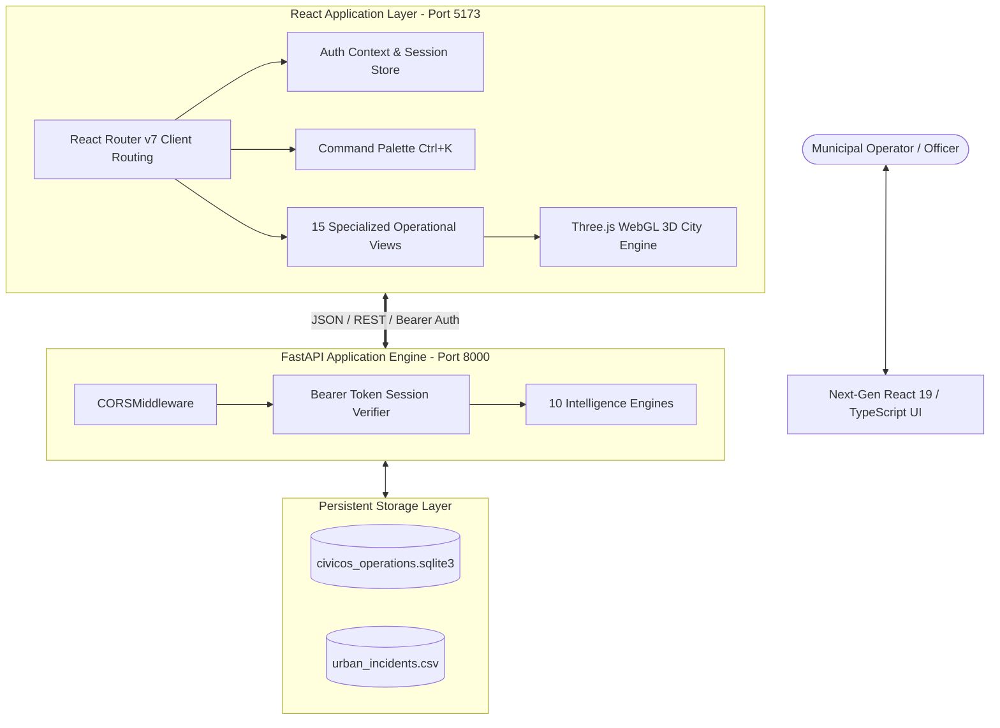

# CivicOS Next-Generation 3D Command Center — System Architecture

## 1. Architectural Overview
The CivicOS Command Center is structured as a decoupled, high-performance modern web application operating directly on top of the validated FastAPI backend and SQLite operational engine.

---

## 2. Technology Stack

| Layer | Component | Version / Specification | Rationale |
|---|---|---|---|
| Runtime | Node.js | v24.20.0 | High-performance modern JavaScript runtime |
| Build Tool | Vite | v8.3.5 | Sub-second bundling, native ES modules |
| UI Framework | React | v19.3.1 | Declarative component model with hooks |
| Language | TypeScript | v7.0.2 | End-to-end type safety, strict compile checks |
| 3D Engine | Three.js | v0.187.0 | Hardware-accelerated WebGL city visualization |
| CSS Architecture | Tailwind CSS | v3.4.17 + PostCSS | Tokenized utility-first design system |
| State & Auth | React Context + LocalStorage | Custom resilient layer | Token persistence with instant refresh |
| API Layer | Axios | v1.21.0 | Interceptors for Bearer token & auto-logout |
| Python Backend | FastAPI + Uvicorn | Python 3.10.11 | High throughput ASGI REST APIs |
| Database | SQLite3 | WAL Mode enabled | ACID compliant transactional operations |

---

## 3. Route & View Inventory

| Route | Page Component | Feature Covered | Primary API Dependencies |
|---|---|---|---|
| `/login` | `Login.tsx` | Authentication & Demo Access | `POST /api/auth/login` |
| `/` | `Dashboard.tsx` | Command Center Overview | `GET /health`, `GET /api/incidents/summary`, `GET /api/incidents` |
| `/map` | `LiveMap.tsx` | 3D Interactive City Twin | `GET /api/geospatial/hotspots`, `GET /api/geospatial/map-layers` |
| `/features/graph` | `RelationshipGraph.tsx` | F1: Incident Relationship Graph | `GET /relationships` |
| `/features/geospatial` | `GeospatialIntelligence.tsx` | F2: Hotspot Detection (DBSCAN) | `GET /api/geospatial/hotspots` |
| `/features/predictive` | `PredictiveML.tsx` | F3: Predictive ML Risk Model | `POST /api/predict/risk`, `GET /api/predict/model-metrics` |
| `/features/cascade` | `CascadingImpact.tsx` | F4: Infrastructure Failure Propagation | `POST /cascade` |
| `/features/impact` | `ImpactSeverity.tsx` | F5: Composite Impact & Severity | `POST /api/scoring/evaluate` |
| `/features/priority` | `SmartPriority.tsx` | F6: Smart Priority Scoring Engine | `POST /api/scoring/evaluate` |
| `/features/whatif` | `WhatIfSimulation.tsx` | F7: Scenario What-If Simulation | `POST /api/simulation/what-if` |
| `/features/recommendations`| `PreventiveRecommendations.tsx`| F8: AI Action Playbooks | `POST /api/recommendations` |
| `/features/prevention` | `PreventionImpact.tsx` | F9: Prevention ROI & Budget Impact | `POST /api/recommendations` |
| `/features/weather` | `WeatherRisk.tsx` | F10: Climate-Correlated Risk Engine| `POST /api/weather/analyze` |
| `/operations/intake` | `IncidentIntake.tsx` | Operational Incident Intake | `POST /api/incidents` |
| `/operations/work-orders` | `WorkOrders.tsx` | Work Order Dispatch & Resolution | `GET /api/work-orders`, `PATCH /api/work-orders/{id}/*` |

---

## 4. 3D WebGL Digital Twin Architecture

The 3D City Visualization component (`src/pages/LiveMap.tsx`) features:
1. **Procedural Building Generation**: Synthesizes a structured city grid based on Bengaluru's urban coordinates.
2. **Dynamic Hotspot Beacons**: Queries `/api/geospatial/hotspots` in real time, projecting spatial coordinates onto a 3D coordinate system. Cylindrical vertical light shafts and pulsing spherical markers indicate cluster severity.
3. **Dual Projection Modes**:
   - *Orbit 3D*: Continuous 360-degree orbital perspective around city center.
   - *Top-Down 2D*: Orthographic tactical situational view for incident coordination.
4. **Memory Management & Fallback**: Automatically disposes Three.js scene geometries, materials, and requestAnimationFrame handles on unmount.
